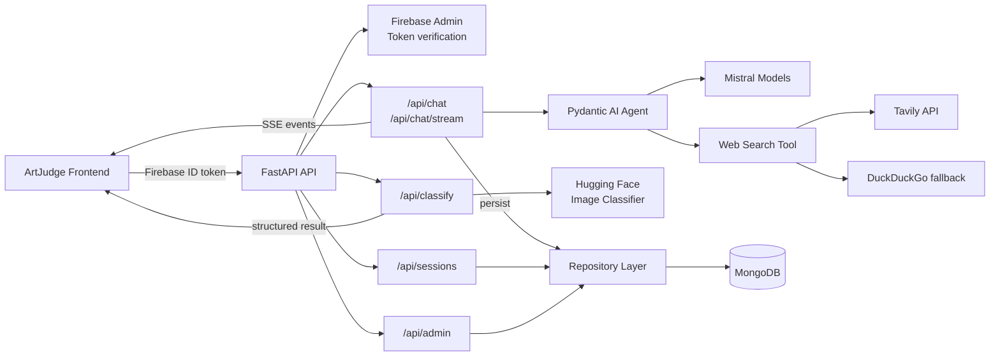
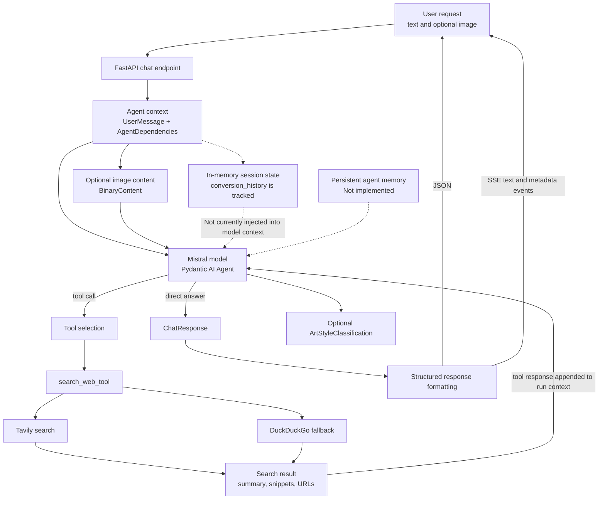

# ArtJudge Backend

ArtJudge is an AI-powered art education backend. It provides authenticated chat
with an art-history assistant, image-based art-style classification, searchable
conversation history, and an administrator API for usage insights.

The service is built with FastAPI and uses:

- **Mistral** through Pydantic AI for conversational responses, image-aware chat,
  web-assisted art-history answers, and session title generation.
- **Hugging Face Transformers** for the direct `/api/classify` image-classification
  endpoint.
- **Firebase Admin** for verifying frontend-issued Firebase ID tokens.
- **MongoDB** through Motor for users, sessions, and messages.
- **Tavily**, with a DuckDuckGo fallback, for optional web search.

## Frontend

The companion frontend is available at
[Isaac-Chow/ArtJudge-front](https://github.com/Isaac-Chow/ArtJudge-front).

## Application architecture



### Request flow

1. The frontend authenticates the user with Firebase and sends the resulting
   bearer token to protected API endpoints.
2. FastAPI verifies the token with Firebase Admin before handling the request.
3. Chat requests are passed to the Pydantic AI agent. The agent can call the
   web-search tool when art-history context or sources are useful.
4. Chat responses and metadata are persisted in MongoDB. Streaming chat sends
   `thinking`, `text`, `metadata`, `title`, and `done` Server-Sent Events.
5. Image uploads to `/api/classify` are validated, classified by the configured
   Hugging Face model, and returned as a structured art-style result.

## Agentic architecture

The conversational path uses a Pydantic AI agent backed by Mistral. The agent
decides whether it can answer directly or should call a tool, then receives the
tool result before producing the final structured response.



### Agent and memory flow

1. The chat endpoint creates an agent input from the user's text and optional
   image, together with the session's `AgentDependencies`.
2. The Mistral model can answer directly or request the registered
   `search_web_tool`. Search uses Tavily when configured and falls back to
   DuckDuckGo, then returns summaries, snippets, and source URLs to the agent
   context.
3. When an image is included, it is passed to the Mistral vision-capable agent
   as binary content. The agent can return an `ArtStyleClassification` alongside
   its conversational explanation.
4. The agent produces a `ChatResponse`. The regular endpoint returns JSON;
   the streaming endpoint emits the response as SSE text, metadata, and
   completion events.
5. Session state currently tracks `conversion_history` in process memory, but
   that history is not yet supplied back to the Mistral model as conversation
   context. MongoDB stores users, sessions, and messages for retrieval, but a
   persistent memory-recall layer for agent runs is **not implemented**.

## API overview

| Endpoint | Authentication | Purpose |
| --- | --- | --- |
| `GET /api/health` | No | Service health check |
| `POST /api/auth/verify` | Firebase bearer token | Verify a token and upsert the user |
| `POST /api/chat` | Firebase bearer token | Return a structured conversational response |
| `POST /api/chat/stream` | Firebase bearer token | Stream a response over SSE |
| `POST /api/classify` | Firebase bearer token | Classify a PNG, JPEG, or WebP upload |
| `GET /api/sessions` | Firebase bearer token | List the signed-in user's sessions |
| `GET /api/sessions/{session_id}/messages` | Firebase bearer token | Load messages owned by the user |
| `GET /api/admin/*` | Firebase bearer token + admin email | Access aggregate and user/session data |

Once the server is running, interactive OpenAPI documentation is available at
`http://localhost:8000/docs`.

## Prerequisites

- Python 3.11 or newer
- MongoDB running locally or a reachable MongoDB deployment
- A Firebase Admin service-account JSON file
- A Mistral API key
- A Tavily API key is optional; without it, the web-search tool falls back to
  DuckDuckGo's Instant Answer API
- A Hugging Face token is optional unless the selected classifier model requires
  authentication

## Configuration

Copy the example environment file and fill in the required values:

```bash
cp .env.example .env
```

At minimum, configure:

```dotenv
MISTRAL_API_KEY=your-mistral-api-key
MONGO_URI=mongodb://localhost:27017
MONGO_DB_NAME=artjudge
ADMIN_EMAIL=your-admin@gmail.com
```

Configure Firebase credentials with `FIREBASE_KEY`:

- Set it to the path of a service-account JSON file, or
- Place a matching `*firebase-adminsdk*.json` file in `cloud/` for local
  development.

`ART_CLASSIFIER_MODEL` defaults to
`dima806/painting-style-classifier`. Set it to another compatible
Hugging Face image-classification model when needed.

Never commit `.env` or Firebase service-account files. Both are ignored by the
repository.

## Local development

Create an environment, install dependencies, and start the development server:

```bash
python3.11 -m venv .venv
source .venv/bin/activate
python -m pip install --upgrade pip
pip install -r requirements.txt
uvicorn main:app --reload --host 0.0.0.0 --port 8000
```

The API will be available at `http://localhost:8000`.

MongoDB must be reachable before the application starts. On startup, the
application creates the indexes needed for users, sessions, and messages.

## Docker

Build and run the backend with Docker:

```bash
docker build -t artjudge-backend .
docker run --rm -p 8000:8000 --env-file .env artjudge-backend
```

The container listens on port `8000`. If Firebase credentials are mounted into
the container rather than copied into the image, set `FIREBASE_KEY` to the
mounted path, for example `/etc/secrets/firebase-service-account.json`.

## Project structure

```text
.
├── main.py                  # FastAPI application and core endpoints
├── auth.py                  # Firebase token verification dependencies
├── models.py                # Pydantic request and response models
├── agent.py                 # Mistral/Pydantic AI agent and web-search tool
├── streaming.py             # Server-Sent Events chat implementation
├── sessions.py              # User session and title endpoints
├── admin.py                 # Admin-only endpoints
├── repositories.py          # MongoDB persistence helpers
├── db.py                    # MongoDB client and index initialisation
└── tools/
    ├── art_classifier.py    # Hugging Face image classification
    └── web_search.py        # Tavily and DuckDuckGo search adapters
```

## Contributors

- [Isaac Chow](https://github.com/Isaac-Chow)
- [Billy Ndegwah Micah](https://github.com/Billy-06)

Contributions are welcome. Please open an issue or pull request with a clear
description of the proposed change and any relevant setup or testing notes.
